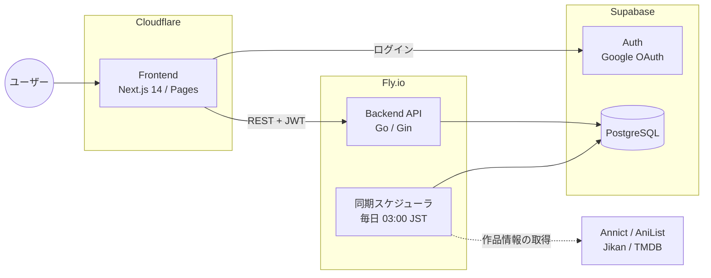
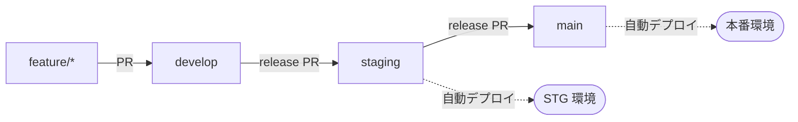

<div align="center">

# 📺 MyAnimeLogs

**見たアニメを、ちゃんと残す。**<br>
今期アニメのチェックから視聴記録まで、アニメファンのための視聴管理 Web アプリ

[](./backend/go.mod)
[](./frontend/package.json)
[](./frontend/package.json)
[](./supabase)
[](./backend/fly.toml)
[](./.github/workflows/deploy-production.yml)

[機能](#-主な機能) ・ [アーキテクチャ](#-アーキテクチャ) ・ [ローカル開発](#-ローカル開発) ・ [API](#-api) ・ [デプロイ](#-デプロイとブランチ運用) ・ [ドキュメント](#-関連ドキュメント)

</div>

---

## ✨ 主な機能

| | 機能 | 内容 |
|---|---|---|
| 🔎 | **アニメ検索** | タイトル・ジャンル・シーズン・メディア種別での絞り込み、入力サジェスト、検索履歴 |
| 📅 | **今期・人気アニメ** | 今期の放送作品と人気作品の一覧。放送予定・放送中・放送終了を放送日から自動判定 |
| 🎬 | **作品詳細** | あらすじ・ジャンル・配信サービス・関連作品（シリーズ作品）を 1 ページに集約 |
| 📝 | **視聴ステータス** | 作品ごとに「視聴予定」「視聴中」「視聴済」を記録 |
| ❤️ | **お気に入り** | 気に入った作品をまとめて管理 |
| 🔐 | **Google ログイン** | 認証は Google ソーシャルログインのみ。アカウントはいつでも完全削除可能 |

> [!NOTE]
> 評価（rating）機能は 2026-06 に撤去しました（migration `043_drop_user_ratings_table`）。

---

## 🏗 アーキテクチャ



### 外部データソース

作品データは複数の API から集めて統合しています。MAL ID（Annict から取得）が AniList・Jikan・TMDB を横断する検索キーです。

| API | 用途 | レート制限 |
|---|---|---|
| [Annict](https://developers.annict.com/) | 作品の基本情報・放送枠・シリーズ | 5 req/秒 |
| [AniList](https://docs.anilist.co/) | カバー画像・ジャンル・放送開始日 | 90 req/分 |
| [Jikan](https://jikan.moe/) | 放送情報（補助） | 3 req/秒 |
| [TMDB](https://developer.themoviedb.org/) | 日本語あらすじ・配信サービス | 40 req/10秒 |
| [Claude API](https://docs.anthropic.com/) | あらすじの日本語翻訳・整形（任意） | — |

---

## 🧰 技術スタック

| レイヤー | 採用技術 |
|---|---|
| **Frontend** | Next.js 14 (App Router) · React 18 · TypeScript 5 · Tailwind CSS · TanStack Query · Orval（OpenAPI クライアント生成） |
| **Frontend 開発** | Jest · Storybook 8 · MSW |
| **Backend** | Go 1.26 · Gin · golang-jwt（Supabase JWT の検証） · Redis（キャッシュ） |
| **Database / Auth** | Supabase（PostgreSQL · Auth） |
| **Infra** | Fly.io（Backend） · Cloudflare Pages（Frontend） · Cloudflare Access（STG / 本番の保護） |
| **CI/CD** | GitHub Actions |
| **API 仕様** | OpenAPI 3.0（[`openapi/openapi.yaml`](./openapi/openapi.yaml)） |

---

## 📁 ディレクトリ構成

```
MyAnimeLogs/
├── backend/                  # Go API サーバー
│   ├── cmd/server/           # エントリーポイント
│   ├── internal/
│   │   ├── handlers/         # HTTP ハンドラー
│   │   ├── services/         # ビジネスロジック・外部 API クライアント
│   │   ├── scheduler/        # 作品データの定期同期
│   │   ├── repository/       # DB アクセス
│   │   ├── models/           # データモデル
│   │   ├── router/           # ルーティング
│   │   ├── middleware/       # 認証・CORS など
│   │   └── ...               # config / database / migration / utils など
│   ├── migrations/           # SQL マイグレーション（起動時に自動実行）
│   ├── scripts/              # 手動同期・運用スクリプト
│   ├── env/                  # 環境変数テンプレート
│   └── fly.toml              # Fly.io 設定（本番）
├── frontend/                 # Next.js アプリ
│   ├── src/
│   │   ├── app/              # App Router のページ
│   │   ├── components/       # UI コンポーネント
│   │   ├── hooks/ contexts/  # カスタムフック・コンテキスト
│   │   ├── lib/              # API クライアント・ユーティリティ
│   │   └── testing/          # テスト用モック（MSW）
│   ├── functions/            # Cloudflare Pages Functions
│   └── env/                  # 環境変数テンプレート
├── supabase/                 # ローカル Supabase 設定
├── openapi/                  # API 仕様書
├── api-tests/                # HTTP リクエスト集（test.http）
├── docs/                     # 設計ドキュメント
├── Makefile                  # ローカル環境の起動・停止
└── docker-compose.yml        # frontend / backend / redis
```

---

## 🚀 ローカル開発

### 前提条件

- Docker & Docker Compose
- Git
- Node.js（ルートで `npm install` を実行して依存を取得）

> [!TIP]
> [Supabase CLI](https://supabase.com/docs/guides/local-development/cli/getting-started) は `package.json` の依存として同梱しているため、**グローバルインストールは不要**です。Makefile は `node_modules/.bin/supabase` を使うので、環境ごとの版ズレが起きません（brew などで別途入れると版ズレの原因になります）。

### 1. クローンと依存の取得

```bash
git clone https://github.com/Action0358/MyAnimeLogs.git
cd MyAnimeLogs
npm install
```

### 2. 環境変数の設定

各サービスの `env/` に、環境別のテンプレート（`local.example` / `staging.example` / `production.example`）があります。

```bash
cp backend/env/local.example backend/.env.local
cp frontend/env/local.example frontend/.env.local
```

外部 API キー（`ANNICT_API_KEY` など）は `backend/.env.local` に記入してください。Supabase 関連の値はローカル CLI の既定値なので変更不要です。

### 3. 起動

```bash
make local-up
```

内部では次の 3 つを順に実行します。

1. `supabase start`（初回は Docker イメージの取得で数分かかります）
2. `supabase status -o env` から anon key を取り出し、`frontend/.env.local` の `NEXT_PUBLIC_SUPABASE_ANON_KEY` を更新
3. `docker compose up -d` でアプリを起動

> [!NOTE]
> 初回起動時、バックエンドは全シーズンの作品データを外部 API から同期します。すべて揃うまで数十分かかります。

<details>
<summary><b>手動で起動する場合</b></summary>

CLI は同梱版を使うため `npx supabase` で呼び出します。

```bash
npx supabase start              # 出力された "anon key" を控える
# frontend/.env.local の NEXT_PUBLIC_SUPABASE_ANON_KEY を書き換える
docker compose up -d
```

</details>

### 4. Google OAuth の設定（初回のみ）

ログインには Google の OAuth クライアントが必要です。

1. [Google Cloud Console](https://console.cloud.google.com/apis/credentials) で「OAuth 2.0 クライアント ID」（種類: ウェブアプリケーション）を作成
2. 「承認済みのリダイレクト URI」に `http://localhost:54321/auth/v1/callback` を登録
3. 発行された client ID / secret を**シェルの環境変数**として渡し、Supabase を作り直す（`supabase/config.toml` が `env(...)` で参照します）

```bash
export SUPABASE_AUTH_EXTERNAL_GOOGLE_CLIENT_ID="xxxxx.apps.googleusercontent.com"
export SUPABASE_AUTH_EXTERNAL_GOOGLE_SECRET="xxxxx"
make local-supabase-down && make local-up
```

> [!CAUTION]
> **シークレットは絶対にコミットしないでください。** `.env.local` ではなく、シェルの環境変数（`~/.zshrc` や direnv など）で渡します。

<details>
<summary><b><code>redirect_uri_mismatch</code> になる場合・設定の確認方法</b></summary>

`127.0.0.1` と `localhost` は別物として扱われます。Supabase は既定で `api_url`（`http://127.0.0.1`）からコールバック URL を組み立てますが、Google のリダイレクト URI は完全一致で判定されるため、そのままでは `redirect_uri_mismatch` になります。`supabase/config.toml` の `[auth.external.google]` で `redirect_uri` に `localhost` を明示して回避しています。

設定が反映されたかは、次のコマンドで確認できます。

```bash
curl -sI "http://localhost:54321/auth/v1/authorize?provider=google&redirect_to=http%3A%2F%2Flocalhost%3A3000%2Fauth%2Fcallback" | grep -i location
```

</details>

### 5. 動作確認

http://localhost:3000/login を開き、「Googleでログイン」から同意画面を経て `/auth/callback` に戻れば成功です。初回ログイン時は、バックエンドが `users` 行を自動作成し、表示名に Google のプロフィール名を入れます。

| サービス | URL | 用途 |
|---|---|---|
| Frontend | http://localhost:3000 | Next.js 開発サーバー |
| Backend API | http://localhost:8080 | Go / Gin API |
| Supabase API | http://localhost:54321 | Auth / REST / Storage |
| Supabase Studio | http://localhost:54323 | DB 管理 GUI |

### 6. 停止

```bash
make local-stop          # アプリ + Supabase を全停止
make local-down          # アプリのみ停止（Supabase は残す）
make local-supabase-down # Supabase のみ停止
```

<details>
<summary><b>🩹 Docker Desktop の再起動後に backend が起動しない</b></summary>

Docker Desktop を終了すると、Supabase のコンテナはすべて強制停止されます。この状態で `docker compose up -d` すると、backend が起動時のマイグレーションで DB（`localhost:54322`）に接続できず `exit status 1` で落ちます。

```
Failed to ping database (attempt 1/5): dial tcp ...:54322: connect: connection refused
```

`supabase start` は「already running」と誤認して復旧できないため、次を使ってください。既存コンテナをそのまま起動するので、DB のデータは保たれます。

```bash
make local-recover
```

</details>

---

## 🛠 開発コマンド

### Backend

```bash
cd backend && make run          # 起動
cd backend && go build ./...    # ビルド確認
cd backend && go test ./...     # テスト
cd backend && make migrate      # マイグレーション実行
```

> [!IMPORTANT]
> Go のコードを変更したとき、またはマイグレーションを含む変更を pull したときは、**必ずコンテナを再ビルド**してください。`restart` では古いバイナリのまま動き、DB とコードが食い違ってログインまで失敗します。
>
> ```bash
> docker compose up -d --build backend
> ```

### Frontend

```bash
cd frontend && npm run dev            # 開発サーバー
cd frontend && npx tsc --noEmit       # 型チェック
cd frontend && npm test               # テスト
cd frontend && npm run lint           # Lint
cd frontend && npm run storybook      # Storybook
cd frontend && npm run generate:api   # OpenAPI からクライアントを生成
```

> [!WARNING]
> ローカルでは `frontend/` で `npm run build` を実行しないでください。起動中の開発サーバーが使う `.next` を上書きして壊します。

---

## 📡 API

仕様の正本は [`openapi/openapi.yaml`](./openapi/openapi.yaml) です。動作確認用のリクエスト集は [`api-tests/test.http`](./api-tests/test.http) にあります。

> 認証は Supabase Auth が担当します。ログインはフロントエンドから Supabase へ直接行い、バックエンドは Supabase が発行した JWT を検証します。

<table>
<tr><th>分類</th><th>エンドポイント</th><th>内容</th><th>認証</th></tr>
<tr><td rowspan="5">アニメ</td><td><code>GET /api/animes</code></td><td>検索・一覧</td><td>任意</td></tr>
<tr><td><code>GET /api/animes/{id}</code></td><td>詳細（関連作品を含む）</td><td>任意</td></tr>
<tr><td><code>GET /api/animes/current</code></td><td>今期アニメ</td><td>—</td></tr>
<tr><td><code>GET /api/animes/popular</code></td><td>人気アニメ</td><td>—</td></tr>
<tr><td><code>GET /api/filters</code></td><td>絞り込み条件の選択肢</td><td>—</td></tr>
<tr><td rowspan="4">検索</td><td><code>GET /api/search/advanced</code></td><td>詳細検索</td><td>任意</td></tr>
<tr><td><code>GET /api/search/suggestions</code></td><td>入力サジェスト</td><td>—</td></tr>
<tr><td><code>GET /api/search/popular</code></td><td>人気の検索語</td><td>—</td></tr>
<tr><td><code>GET · DELETE /api/search/history</code></td><td>検索履歴の取得・削除</td><td>必須</td></tr>
<tr><td rowspan="2">ユーザー</td><td><code>GET /api/users/me</code></td><td>プロフィール取得</td><td>必須</td></tr>
<tr><td><code>DELETE /api/users/me</code></td><td>アカウントの完全削除</td><td>必須</td></tr>
<tr><td rowspan="2">記録</td><td><code>GET /api/users/me/favorites</code><br><code>PUT · DELETE /api/users/me/favorites/{anime_id}</code></td><td>お気に入り</td><td>必須</td></tr>
<tr><td><code>GET /api/users/me/watch-status</code><br><code>PUT · DELETE /api/users/me/watch-status/{anime_id}</code></td><td>視聴ステータス</td><td>必須</td></tr>
</table>

管理用の同期 API（`/api/admin/*`）もあります。詳細は [`backend/internal/router/router.go`](./backend/internal/router/router.go) を参照してください。

---

## 🗄 データベース

| 項目 | 値 |
|---|---|
| ホスト / ポート | `localhost:54322` |
| データベース | `postgres` |
| 管理ツール | [Supabase Studio](http://localhost:54323) |

| テーブル | 内容 |
|---|---|
| `users` | ユーザー情報（Supabase Auth のユーザーと紐づく） |
| `animes` | 作品情報 |
| `anime_genres` | 作品のジャンル |
| `user_favorites` | お気に入り |
| `user_watch_status` | 視聴ステータス |
| `search_logs` | 検索履歴 |
| `sync_stats` | 同期処理の記録 |

> [!NOTE]
> 放送状態（放送予定・放送中・放送終了）は、ビュー `animes_with_computed_status` が放送開始日とシーズンから算出します。DB 上の `status` に入る値は `airing` / `finished` / `upcoming` の 3 つだけです。

---

## 🚢 デプロイとブランチ運用



`staging` と `main` への push で GitHub Actions が自動デプロイします。マイグレーションはバックエンドの起動時に自動で適用されます。

| | 本番（Production） | ステージング（Staging） |
|---|---|---|
| **URL** | https://myanimelogs.com | https://stg.myanimelogs.com |
| **ブランチ** | `main` | `staging` |
| **Frontend** | Cloudflare Pages | Cloudflare Pages（別プロジェクト） |
| **Backend** | Fly.io `myanimelogs-production` | Fly.io `myanimelogs-staging` |
| **Database** | Supabase（ref: `uvzlwyxclzrpnzioaspr`） | Supabase（ref: `lvvyolsqhtzfgxsheikr`） |
| **アクセス制限** | Cloudflare Access（ベータ公開前のため） | Cloudflare Access |

> [!WARNING]
> 本番の Cloudflare Access は、Google OAuth 同意画面の公開を妨げます。Google は公開時にプライバシーポリシー・利用規約の URL へ外部からアクセスして検証するため、Access を外すまで「アプリを公開」を実行できません（issue #745）。

<details>
<summary><b>🔑 STG / 本番の Google OAuth 設定</b></summary>

**`supabase/config.toml` はローカル専用で、Supabase Cloud には反映されません。** STG / 本番では以下をダッシュボードから設定します。設定しないと、その環境ではログインできません。

| 設定対象 | ローカル | STG / 本番 |
|---|---|---|
| Google プロバイダの有効化 | `supabase/config.toml` | Supabase ダッシュボード |
| client ID / secret | シェルの環境変数 | Supabase ダッシュボード |
| コールバック URL の登録先 | Google Cloud Console | Google Cloud Console |

1. **Google Cloud Console** — 環境ごとに OAuth クライアントを分けて作成します（例: `MyAnimeLogs Production`）。シークレットが漏れたときの影響をローカルと切り離すためです。承認済みのリダイレクト URI は `https://<project-ref>.supabase.co/auth/v1/callback` です。
2. **Supabase ダッシュボード** → Authentication → Providers → Google を有効にし、client ID / secret を入力します。
3. **Supabase ダッシュボード** → Authentication → URL Configuration で、Site URL（例: `https://myanimelogs.com`）と Redirect URLs（`https://myanimelogs.com/auth/callback`）を設定します。
4. **OAuth 同意画面の公開** — 「テスト」状態ではテストユーザー（最大 100 人）しかログインできず、リフレッシュトークンも 7 日で失効します。一般公開前に「本番」へ切り替えてください。スコープは `email` / `profile` / `openid` のみなので Google の審査は不要です。公開時にはホームページ・プライバシーポリシー（`/privacy`）・利用規約（`/terms`）の URL が必要です。

> ローカルで必要だった `redirect_uri` の `localhost` 明示は、Cloud では不要です。

> `supabase config push` でも設定を反映できますが、ローカル向けの `redirect_uri` が本番に入ると認証が壊れます。環境ごとの差分の扱いを決めるまでは、ダッシュボードで手動設定してください。

反映されたかは、認可エンドポイントの応答で確認できます。有効なら `302` で Google へリダイレクトし、無効なら `400` を返します。`client_id` と `redirect_uri` が登録値と一致しているかも、このレスポンスで確認できます。

```bash
curl -sI "https://<project-ref>.supabase.co/auth/v1/authorize?provider=google&redirect_to=https%3A%2F%2Fmyanimelogs.com%2Fauth%2Fcallback" | grep -i location
```

</details>

<details>
<summary><b>🔁 パスワード認証から Google 認証への移行</b></summary>

既存ユーザーは次のいずれかの経路で移行します。**どの経路でも `user_id` は変わらず、視聴記録・お気に入りは引き継がれます。**

| 経路 | 条件 | ログ出力 |
|---|---|---|
| `existing` | Supabase が検証済みメールの一致で identity を自動リンク | なし |
| `claimed` | `public.users.auth_user_id` が NULL の行をメールの一致で紐づけ | あり |
| `relinked` | 別の `auth_user_id` が設定済みの行を張り替え | あり |
| `created` | 新規ユーザー | あり |

```bash
flyctl logs -a myanimelogs-production --no-tail | grep "linked users row"
```

移行状況の棚卸しには `backend/scripts/check_google_auth_migration.sql` を使います。

> [!IMPORTANT]
> 移行の進み具合は `raw_app_meta_data->>'provider'`（単数）ではなく `raw_app_meta_data->'providers'`（配列）で判定してください。primary provider は Google へ移行しても `email` のまま変わらないため、単数形を見ると「誰も移行していない」と誤読します。

</details>

---

## 📚 関連ドキュメント

| ドキュメント | 内容 |
|---|---|
| [backend/README.md](./backend/README.md) | バックエンドの詳細 |
| [frontend/README.md](./frontend/README.md) | フロントエンドの詳細 |
| [openapi/openapi.yaml](./openapi/openapi.yaml) | API 仕様書 |
| [docs/](./docs/) | 要件定義・テーブル定義・画面設計などの設計資料 |
| [docs/SECURITY.md](./docs/SECURITY.md) | セキュリティ方針 |
